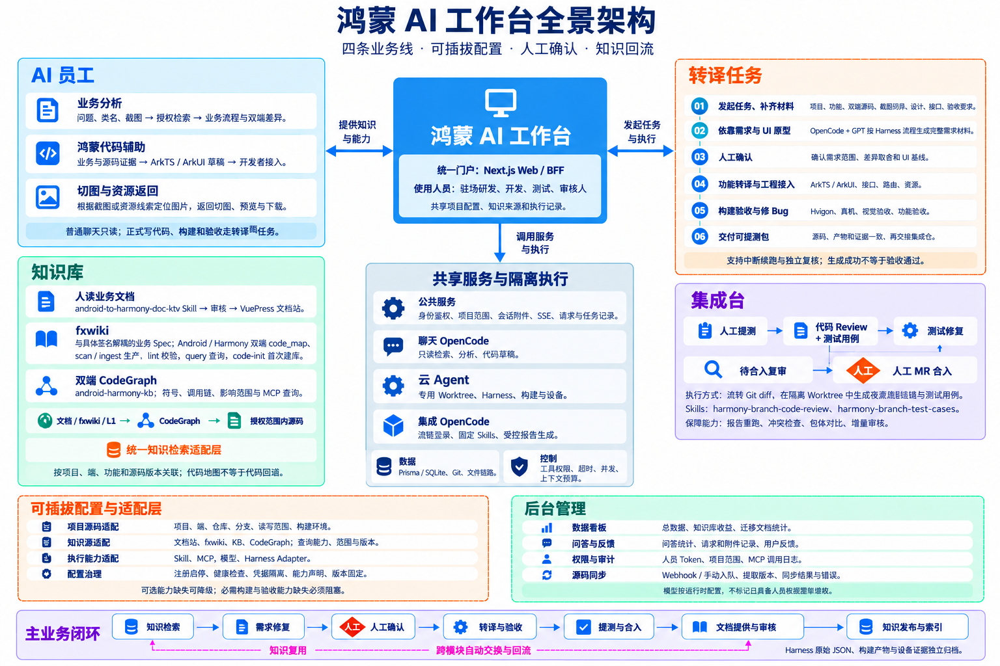

# 鸿蒙 AI 工作台

面向 Android → HarmonyOS 研发，集成知识查询、源码分析、需求转译、构建验收和提测合入。通过统一配置接入不同源码项目与知识库，支持驻场和专职开发协作。

[文档目录](docs/README.md) · [源码与知识库接入](docs/engineering/integrations/android-external-app-repos.md) · [转译台使用](docs/features/cloud-agent.md) · [开发与部署](docs/engineering/development.md)

转译台的源码编码、构建和设备验收能力由 [Android to Harmony Migration Harness](https://github.com/tencentmusic/android-to-harmony-harness) 提供；使用转译台前请按该项目说明准备 Harness 运行环境。

[开源能力范围全景图](docs/assets/overview/open-source-capabilities.svg)

## 一、全景架构

[](docs/assets/overview/workbench-panorama.png)

**源码与知识接入 → 统一配置与适配 → 四个业务模块 → 研发交付与知识回流。** 点击图片查看原图。

## 二、核心功能

| 模块 | 能力 |
| --- | --- |
| **AI 员工** | 结合业务知识和双端源码答疑，定位代码、追调用链、分析端间差异 |
| **知识库** | 浏览与检索业务规则、CodeGraph、迁移案例，从文档继续询问 AI |
| **转译台** | 需求查证、Scope/UI 审核、Harness 编码、独立审查、构建与设备验收 |
| **集成台** | 承接提测分支，组织代码审查、测试、修复复审与合入协作 |
| **平台管理** | Token、模型与 App 权限管理；问答、知识命中、MCP 和文档阅读看板；Webhook 监听、源码与知识库自动更新、自动部署及执行记录 |

转译台交付流程：

**需求材料 → 分析与人工确认 → 编码、审查与构建 → 设备结论 → 开发复核提测 → 集成与人工合入 → 知识回流**

设备验收如实记录通过、失败或未完成结论，保留缺项进入后续交接；开发本地复核并确认后才创建集成单。代码与知识合入仍由人决定。

[查看详细流程 SVG](docs/assets/overview/lifecycle.svg) · [转译台交付配置](docs/operations/cloud-agent-delivery.md)

## 三、灵活配置

资源统一登记在 [config/workspace-apps.json](config/workspace-apps.json)：**Project 定义源码，App 定义模块范围，Knowledge 组合知识源，Profile 选择机器路径。**

| 接入方式 | 项目示例 |
| --- | --- |
| **独立源码项目** | 示例项目 `demo-project`：独立配置 Android / HarmonyOS 源码，`DemoApp` 指定模块范围 |
| **多 App 共享大仓** | 多应用示例：共享项目源码，由不同 App 分别配置 scope |
| **共享或专属知识** | 项目通过 `knowledge[].use` 引用共享源，也可直接配置专属知识；一个项目可组合多个知识源 |
| **多环境运行** | `WORKSPACE_PROFILE` 选择本地或测试服路径；App 的 `cloud_agent` 配置转译、构建和设备 |

示例项目引用双端知识包和迁移案例源；知识查询与源码访问仍按配置和账号授权执行。已有类型可配置接入，新知识协议需增加适配器。

[全局项目配置架构 SVG](docs/assets/workspace-configuration/harmony-workbench-configuration.svg) · [真实 JSON 节选 SVG](docs/assets/workspace-configuration/harmony-workbench-config-example.svg) · [完整接入指南](docs/engineering/integrations/android-external-app-repos.md)

## 四、快速启动

**技术栈**：Next.js 15 · React 19 · TypeScript · Ant Design 5 · Prisma / SQLite。

Web 提供页面与接口，Worker 执行转译和源码同步；AI 员工、集成台使用独立 OpenCode。Harness、DevEco / SDK 与模拟器提供编码、构建和设备取证能力。

[运行架构 SVG](docs/assets/overview/architecture.svg) · [工程架构](docs/engineering/architecture.md)

### 安装 OpenCode

AI 员工和集成台依赖 **OpenCode CLI**，需单独安装；项目的 `npm install` 不会安装它。当前部署脚本固定校验 **1.18.3**：

```bash
npm install -g opencode-ai@1.18.3
opencode --version
```

确认输出 `1.18.3`，且启动工作台的终端能找到该命令。Windows 若无法启动，可在 `.env` 中用 `OPENCODE_BIN` 指定实际的 `opencode.exe` 绝对路径；独立目录安装可配置 `OPENCODE_HOME`，默认查找 `D:/soft/opencode`。

模型密钥及两套服务密码按 `.env.example` 配置。后续 `dev:stack` 自动启动 AI 员工（4098）和集成台（4110）两个独立实例，无需手动运行 `opencode serve`。详见 [OpenCode 配置](runtime/opencode/README.md)。

### 本地运行

准备 Node.js ≥ 22.13、Git 和所需源码 / 知识仓。复制 [.env.example](.env.example) 为 `.env`，配置模型服务与当前 Profile 的实际路径。执行转译还需准备 Harness、DevEco / SDK 和模拟器环境。

```bash
npm install
npm run validate:workspace-apps
npm run db:push
npm run dev:stack
```

- 工作台：http://localhost:3100/login
- 管理后台：http://localhost:3100/admin/login
- 知识库：http://localhost:3100/knowledge

`dev:stack` 启动完整开发栈；仅调试 Web 页面使用 `npm run dev`。资源路径写入项目配置，密钥写入环境文件，不提交实际环境文件。

### 提交与部署

从最新 `origin/release` 创建 `feature/*` 或 `fix/*` 分支，经 MR 合入后触发部署。生产使用 `.env.production`，部署流程执行 `npm run deploy`；测试服只用于部署和验收。

SQLite 相对路径以 `prisma/` 为基准，表结构以 `prisma/schema.prisma` 为准；同步出现数据丢失提示时先检查，不直接确认。

[提交部署规范](docs/engineering/development.md) · [Webhook 同步](docs/operations/repo-sync-webhook.md) · [转译运行与恢复](docs/operations/cloud-agent.md) · [OpenCode 配置](runtime/opencode/README.md)
