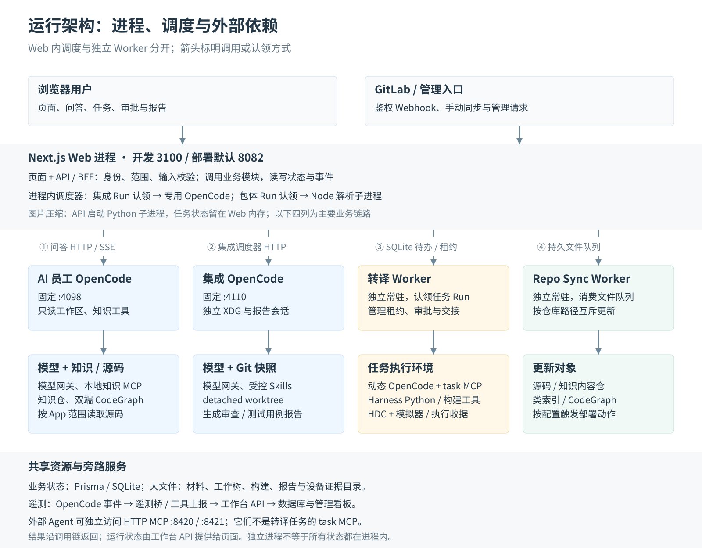
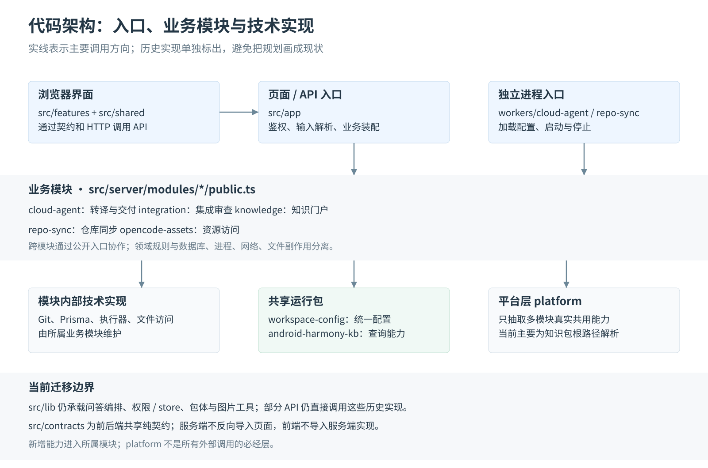
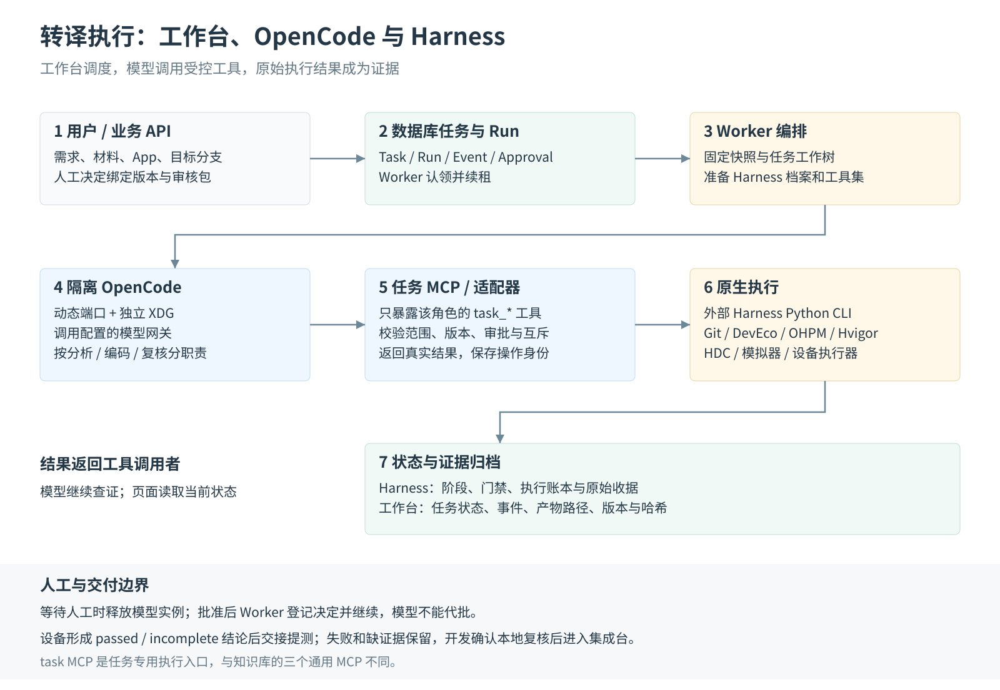

# 工程架构

工作台是 **Next.js 模块化单体 + 独立执行进程**：页面、API 和部分调度器运行在 Web 进程中，
转译与仓库同步由独立 Worker 执行。OpenCode 承载模型会话；外部 Harness 提供转译规则、工程门禁与设备执行合同。

本文说明当前运行关系与代码组织。功能用法见[功能目录](../README.md)，配置字段见[源码与知识库接入](integrations/android-external-app-repos.md)。

## 一、运行全貌

图中箭头表示请求、调度或资源访问；结果与日志沿原调用链返回。数据库和文件目录是共享资源，不是独立业务服务。

- **浏览器只访问工作台 API**：登录、App 授权、会话归属、参数和材料校验由工作台处理。
- **模型负责推理，平台负责执行**：OpenCode 调用允许的工具；Git、构建、设备操作由对应适配器执行并保存结果。
- **长任务有不同执行方式**：集成和包体对比由 Web 内调度器认领；转译和 Repo Sync 由常驻 Worker 认领。
- **源码与知识分开接入**：源码提供当前实现，外部知识仓提供文档与 manifest，CodeGraph 提供已索引的符号和调用关系。

### 进程与端口

端口为默认值，实际值以部署配置为准。

| 进程 / 组件 | 启动与监听 | 负责什么 |
| --- | --- | --- |
| Web：Next.js / React / Ant Design | 开发 `3100`，生产部署默认 `8082` | 页面、API、鉴权、流式响应、门户、管理后台 |
| 集成调度器 | Web 启动时初始化，无独立端口 | 认领集成运行，调用专用 OpenCode，保存报告 |
| 包体调度器 | Web 启动时初始化，无独立端口 | 从数据库认领分析，启动独立 Node 解析子进程 |
| AI 员工 OpenCode | `127.0.0.1:4098` | 只读问答、会话续聊、知识与源码工具调用 |
| 集成 OpenCode | `127.0.0.1:4110` | 隔离的审查和测试用例 Skill 执行 |
| 转译 Worker | `workers/cloud-agent/index.mjs`，无固定监听端口 | 数据库认领、租约续期、任务执行、通知和交付跟踪 |
| 转译任务 OpenCode | Worker 按需启动，动态 loopback 端口 | 分析、编码、独立代码审查、设备复核等职责会话 |
| Repo Sync Worker | `workers/repo-sync/index.mjs`，无固定监听端口 | 消费文件队列，更新仓库、索引并触发配置的部署 |
| 知识 MCP | 本地 stdio；可单独运行 HTTP `8420 / 8421` | 本地知识、驻场查询、双端图谱三个入口 |
| 遥测桥 | 无固定监听端口 | 订阅 OpenCode 事件，向工作台遥测 API 上报 |
| 图片压缩进程 | API 按需启动 Python | Pillow 与图片工具处理文件；任务状态保存在 Web 内存 |

`4098` 和 `4110` 的凭据、XDG 配置/数据目录与工作区隔离；转译任务使用自己的动态实例，不复用这两个固定实例。
普通 OpenCode 原始 API 不对浏览器开放。HTTP MCP 是独立接入面，三个 MCP 的权限与能力见[知识库](../features/knowledge.md#三三个-mcp-怎么选)。

## 二、代码分层与模块职责

| 层 / 路径 | 当前职责 | 依赖约束 |
| --- | --- | --- |
| `src/features/` | AI 员工、转译、集成、管理和工具页面 | 通过 API 调服务端；不导入服务端实现 |
| `src/app/` | 页面装配和 API Route | 新增入口只做鉴权、输入解析、模块调用和响应 |
| `src/contracts/` | 前后端共享类型与协议 | 不读取环境变量，不依赖 Node、框架运行时或业务实现 |
| `src/server/modules/` | 业务编排、状态转换与规则 | 生产调用通过模块 `public.ts`；内部实现不跨模块直接引用 |
| 模块内部适配代码 | Git、数据库、模型、设备和文件副作用 | 保持在所属模块；领域规则与外部副作用分开 |
| `src/server/platform/` | 已抽取的跨模块技术适配 | 至少有两个真实使用方才抽取；目前主要是知识运行包根目录解析 |
| `src/lib/` | 现存问答、权限、存储及工具业务实现 | 历史实现仍在使用；新业务不继续集中到此目录 |
| `workers/` | 常驻进程入口、包体解析子进程 | 常驻入口装配配置并调用模块，不承载整套业务规则 |
| `packages/workspace-config/` | 解析、校验项目与环境配置 | 供源码、知识、执行和同步模块共用 |
| `packages/android-harmony-kb/` | 知识适配、MCP、CodeGraph、遥测 | 读取接入的内容与索引，不维护业务知识事实 |
| `runtime/`、`deploy/`、`scripts/` | 运行配置、代理、启动、部署与运维入口 | 与业务执行代码分开维护 |

**已按模块组织的服务端能力：**

| 模块 | 拥有的职责 |
| --- | --- |
| `cloud-agent` | 任务、材料、审批、Harness 适配、源码工作树、构建/设备证据、交付与恢复 |
| `integration` | 集成状态、Git 快照、运行认领、独立审查、报告校验和清理 |
| `knowledge` | 门户知识源解析、目录、正文、资源、搜索和访问边界 |
| `repo-sync` | Webhook 匹配、队列、仓库更新、索引同步与部署动作 |
| `opencode-assets` | OpenCode 相关资源访问 |

分层约束不等于迁移已经完成：问答入口仍直接编排部分 `src/lib/opencode` 与 store，
包体和图片工具也仍在 `src/lib`；不能将所有数据库、Git、模型调用都画成已经集中到 platform。
新增代码按模块边界落位，既有实现逐步迁移，约束由 `npm run test:architecture` 检查。

## 三、四条主要运行链路

### 1. AI 员工：浏览器到模型与知识

1. 浏览器提交问题、App、会话和附件到 `/api/opencode/chat`。
2. API 校验 Token 与会话归属，解析 App scope、类引用或文档选区，装配所需知识上下文并记录请求。
3. 工作台调用 OpenCode `4098`；OpenCode 经配置的 provider 请求模型网关，并按需调用本地知识 MCP。
4. 知识查询返回规则、章节、案例或代码位置；需要当前实现时，继续按范围查 CodeGraph 和源码。
5. 正文和执行说明经工作台 SSE 返回浏览器；会话消息、请求状态和遥测分别保存。断流保留部分输出并标记未完成。

OpenCode 管理模型会话与工具循环，工作台管理用户身份、App 范围和页面历史。
文档门户可直接读取内容仓，不要求每次阅读都经过模型或 MCP。

### 2. 转译台：任务、模型与 Harness

1. Web 创建任务和材料记录；已配置的 Android 合入 MR 也可经独立收件流程建单。
2. Worker 认领一轮 Run，建立租约，固定材料与源码版本，准备任务工作树和 Harness 档案。
3. Worker 启动该轮 OpenCode 和受控任务工具端点。模型通过 `task_*` 工具访问任务材料、源码及执行能力。
4. 工具适配器检查角色、路径、版本和审批，再调用 Git、外部 Harness Python CLI、构建工具或设备执行器。
5. Harness 保存阶段、门禁和原生执行收据；工作台保存运行状态、事件及产物引用。工具返回观察值，模型继续分析。
6. 需要人工时释放模型实例，页面展示绑定当前版本的审核包；真人决定保存后由 Worker 继续登记与执行。

三个组件各有职责：

| 组件 | 决定什么 |
| --- | --- |
| 工作台 | 谁能执行、执行哪个任务与版本、何时调度、人工记录和交接状态 |
| OpenCode / 模型 | 在角色权限内查证、分析、生成修改与选择下一步工具 |
| Harness | 工程阶段和门禁、证据合同、执行账本、设备操作与验收事实 |

代码审查和构建有效后，设备轮次生成真实的 `passed` 或 `incomplete` 结论。
未完成设备结论仍可进入分支发布与提测交接，保留失败和缺项；开发本地复核确认后创建集成单。
严格验收通过且代码合入核实后才进入知识回流，不用界面状态或模型总结代替通过证据。
鸿蒙模拟器使用截图、真实连续帧与日志，不调用仅真机可用的 HDC 系统录屏服务。

### 3. 集成台：固定提交到报告

1. API 保存集成单，状态变化按规则生成首次审查、测试用例或合入前复审 Run。
2. Web 内集成调度器认领运行，固定 base/head/target 与 diff 摘要，创建 detached worktree。
3. 调用独立 OpenCode `4110`，加载指定 Skill；每份报告使用独立会话，只写受控报告目录。
4. 读取并校验实际报告文件，保存 Artifact 与事件，再确认停止和清理临时工作区。

生成测试用例不代表执行过测试，报告也不会自动合并代码。转译交接使用专用幂等入口，
不重复触发已经完成的交接审查。源提交变化后，旧报告不能继续代表当前代码。

### 4. Webhook：事件到同步与部署

1. GitLab 调用 `/api/webhooks/repo-sync`；API 校验 Secret，匹配仓库和分支，写入持久文件队列。
2. Repo Sync Worker 按目录互斥消费，检查工作区后更新指定分支，记录同步前后 HEAD。
3. 源码变化更新受影响类索引与 CodeGraph；知识仓变化拉取已有内容与 manifest。
4. HEAD 变化且配置了部署动作时执行相应命令；工作台自部署通过分离进程执行，避免当前队列被重启中断。
5. 执行结果写入更新记录，管理后台可查询；未配置的仓库不会自动获得部署或知识生产动作。

同步队列与转译 MR 建单有各自的去重和执行记录；仓库同步成功不等于转译任务已创建。

## 四、状态、队列与产物存储

| 数据 | 保存位置 / 主要模型 | 写入者与读取者 |
| --- | --- | --- |
| 身份、App 授权、模型配置 | SQLite：`ApiToken`、`ApiTokenAppScope`、`ModelConfig` | 管理/API 写；各入口校验读取 |
| 会话与问答记录 | `ChatSession`、`ChatMessage`、`OpencodeRequest` | 问答 API 写；页面历史和审计读取 |
| 转译任务与执行 | `CloudAgentTask/Run/Event/Approval`，收件/通知表 | Web 与独立 Worker 共用，按轮次和租约更新 |
| 集成任务与报告引用 | `IntegrationTask/Run/Artifact/TaskEvent` | API 与 Web 内调度器共用 |
| 包体分析与审核 | `PackageArtifact/Comparison/Analysis/Review` | API、包体调度器写；页面与导出读取 |
| 同步待办 | `data/repo-sync/queue` 文件队列 | Web/API 入队；Repo Sync Worker 消费 |
| 同步与使用审计 | `RepoSyncRun`、`KbSyncRun`、`KbTelemetryEvent`、`DocAnalyticsEvent` | 同步/遥测/阅读入口写；管理看板读取 |
| 转译材料与执行产物 | 默认 `data/cloud-agent/materials`、`.runtime/cloud-agent`，可另配工作树根 | Web 上传，Worker 和 Harness 生成/读取 |
| 集成工作树与报告 | `HARMONY_INTEGRATION_RUNTIME_ROOT` 下受管目录 | 集成执行器创建与校验，数据库保留引用和摘要 |
| 包体与压缩文件 | 默认 `.runtime/package-comparison`、`.runtime/image-compression` | 对应子进程处理，API 鉴权下载 |
| 源码与知识事实 | 外部 Git 工作区、知识 manifest、源码仓 `.codegraph/` | 同步与索引流程更新，查询侧读取 |

SQLite 表结构以 [schema.prisma](../../prisma/schema.prisma) 为准；`DATABASE_URL=file:./data.prod.db`
相对 Prisma 目录解析，即 `prisma/data.prod.db`。OpenCode 自身会话还保存在对应实例的 XDG 数据目录中。

**持久化边界：**

- 转译和集成不是“一个状态字段”：任务、运行、事件、审批、报告和文件收据需要共同核验。
- SQLite 不保存所有大文件；报告/媒体引用必须与文件、版本和哈希匹配。备份需覆盖数据库、材料、有效产物和必要运行状态。
- Repo Sync 待办在文件队列中，不能仅靠数据库审计表重建执行现场。
- 图片压缩任务状态保存在内存，不能承诺服务重启后继续；其文件产物与任务状态是两回事。

## 五、配置和外部依赖

| 配置 / 依赖 | 作用与边界 |
| --- | --- |
| `config/workspace-apps.json` | 源码项目、App scope、知识源引用、机器路径、转译执行和资源同步的统一入口 |
| `WORKSPACE_PROFILE` | 为同一逻辑资源选择本机目录；不是另一个项目定义 |
| `config/repo-sync.json` | 工作台自身更新和同步队列相关配置 |
| 环境文件 | 数据库、服务 URL、凭据、运行根目录及工具路径；不把密钥写入资源配置 |
| `runtime/agents/*/instance.json` 与 OpenCode 配置 | 固定实例、工作区和工具策略；模型配置必须与工作台调用参数一致 |
| 外部 Harness 仓库 | 由 `CLOUD_AGENT_HARNESS_ROOT` 定位；与工作台独立提交、发布和更新 |
| Android / HarmonyOS 仓库 | 查询读取当前源码；转译在任务独立工作树写入鸿蒙实现 |
| 外部知识库 / 案例仓 | 提供当前业务知识或历史证据；内置 KB 包负责读取和适配 |
| 工具链与设备 | Node、OpenCode、Python/视觉依赖、FFmpeg、DevEco/SDK、OHPM/Hvigor、HDC 与模拟器 |
| 模型、GitLab、通知服务 | 执行推理、版本协作和 Webhook 通知；可用性分别核验 |

三个知识 MCP 不等同于转译任务 MCP：前者提供通用查询，后者由任务执行过程建立，
仅暴露该任务当前角色可用的工具，不能拿通用知识连接代替构建、设备或审批接口。

## 六、隔离、并发与故障恢复

| 边界 | 当前处理方式 |
| --- | --- |
| 用户与 App | Token、App scope、资源归属分别校验；知识门户登录访问与源码权限独立 |
| 问答与集成 | 不同 OpenCode 实例、凭据和 XDG 目录；集成工作树不修改开发者目录 |
| 转译任务 | 固定快照、独立工作树、职责会话；同工作树的变更、审查和构建互斥 |
| Worker 并发 | 转译 Worker 单实例锁，内部有限并发；Run 租约避免重复认领，失去租约后停止继续写入 |
| 版本与审批 | 材料、源码、构建、报告及人工决定绑定当前版本，变化后保留历史但重新核验 |
| 执行中断 | 先核对旧进程、工具结算与原收据；未知安装、构建或设备副作用不能直接重放 |
| 仓库更新 | 按路径互斥、分支匹配、工作区检查；不会覆盖任意本地业务修改 |

当前默认部署依赖同机 SQLite 和共享文件目录，Web 与转译 Worker 使用同一数据库。
它不是可直接增加多台 Web/Worker 实例的无状态服务；扩容前需处理数据库、共享存储、租约、内存任务和设备独占。

恢复时区分三类结果：调用失败、业务未通过、执行结果未知。前两类保留原因和真实结论；
结果未知需先查原操作，不能靠换会话或新 operationId 当作未发生。具体命令见[转译恢复手册](../operations/cloud-agent.md)。

## 七、启动、部署与观测

- **本地**：`npm run dev:stack` 管理 Web、两个固定 OpenCode、遥测桥、Repo Sync 和转译 Worker。集成/包体调度器由 Web 初始化；HTTP MCP 网关按需单独启动。
- **生产**：部署脚本负责依赖检查、构建、数据库结构同步与相关进程管理。外部 Harness 与内容仓仍按各自发布规范更新；工作台部署不等于所有外部依赖都已更新。
- **重启影响**：Web 重启会影响问答流和进程内调度器；独立转译/同步进程有各自生命周期。停止整个开发栈则会停止栈内子进程。
- **观测关联**：问答按请求/会话，转译按 task/run/revision/operation，集成按 task/run/artifact，同步按队列项和 runId 查找日志与收据。
- **验证范围**：HTTP 健康只说明服务存活；完整链路还需验证模型连接、知识/源码路径、Harness 依赖、构建工具和真实设备操作。

遥测桥订阅 OpenCode `/global/event`，查询工具和 MCP 也可上报遥测；工作台将事件用于用量、知识命中和调用审计。
看板展示的调用成功、报告生成、设备验收通过是不同指标，不互相替代。

## 八、实现入口与延伸文档

| 要定位的问题 | 入口 |
| --- | --- |
| Web 内调度器何时启动 | [instrumentation-node.ts](../../src/lib/instrumentation-node.ts) |
| 本地有哪些独立进程 | [start-dev-stack.mjs](../../scripts/start-dev-stack.mjs) |
| 问答鉴权与流式编排 | [chat/route.ts](../../src/app/api/opencode/chat/route.ts)、[AI 员工设计](../specs/ai-employee.md) |
| 转译调度、动态模型和 Harness | [worker.ts](../../src/server/modules/cloud-agent/worker.ts)、[runtime.ts](../../src/server/modules/cloud-agent/runtime.ts)、[harness.ts](../../src/server/modules/cloud-agent/harness.ts) |
| 集成认领和报告处理 | [integration-worker.ts](../../src/server/modules/integration/integration-worker.ts)、[集成设计](../specs/integration.md) |
| MCP 能力与配置 | [知识库](../features/knowledge.md)、[知识运行包](../../packages/android-harmony-kb/README.md) |
| 更新、部署和恢复 | [Webhook](../operations/repo-sync-webhook.md)、[转译运行](../operations/cloud-agent.md)、[开发规范](development.md) |
