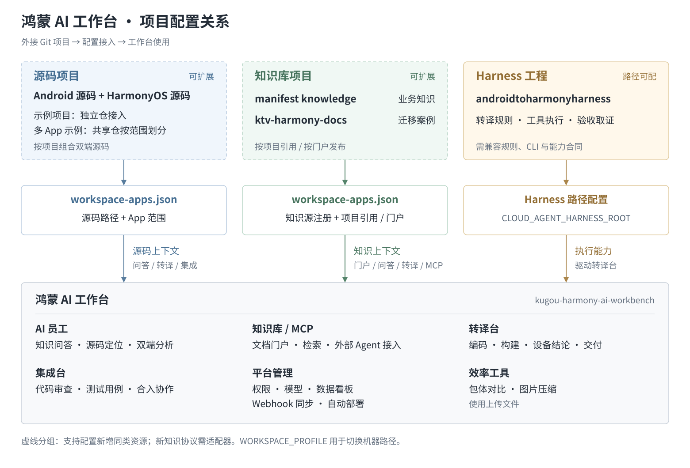
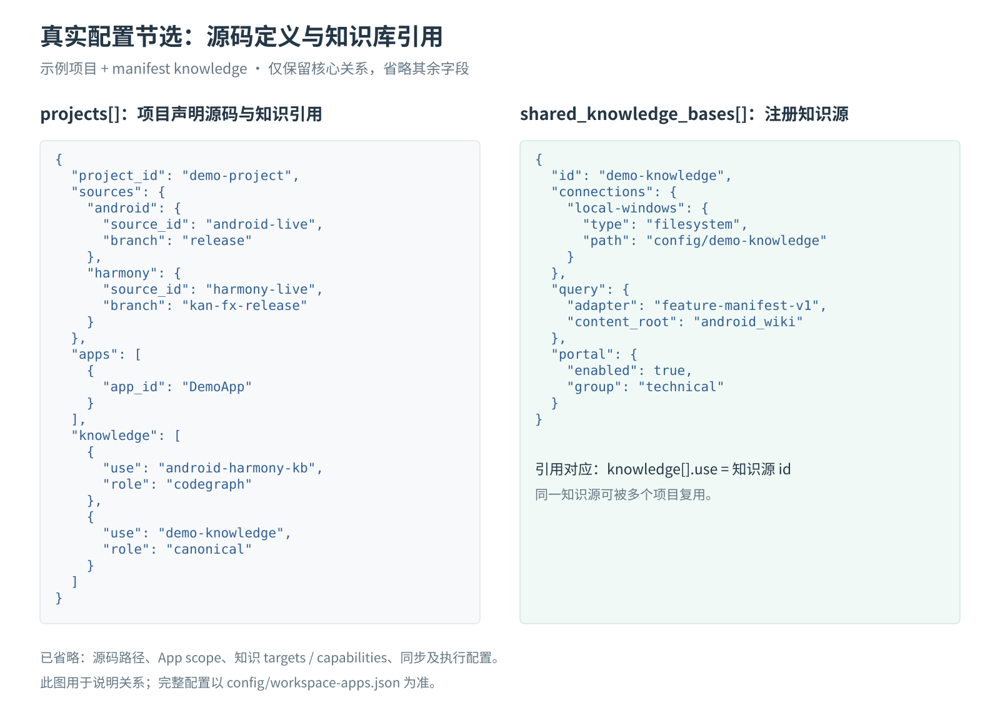

# 源码项目与知识库项目接入

工作台支持配置接入 **Android / HarmonyOS 源码项目**和**知识库项目**，转译能力另依赖外部 **Harness 项目**。
源码与知识资源在 [workspace-apps.json](../../../config/workspace-apps.json) 登记路径、使用范围和同步规则；`WORKSPACE_PROFILE` 选择机器路径，Harness 由 `CLOUD_AGENT_HARNESS_ROOT` 指定工程目录。

## 一、接入关系

[](../../assets/workspace-configuration/harmony-workbench-configuration.svg)

图中三组外接项目经各自配置入口接入工作台：源码用于问答、转译和鸿蒙集成；知识用于门户、问答、转译与 MCP；Harness 提供转译执行能力。工作台功能统一列在下方大框中。
已有源码和知识源类型可按配置扩展；新知识协议需要适配器，Harness 需要兼容其规则、CLI 与能力合同。

| 接入对象 | 配置位置 | 规则 |
| --- | --- | --- |
| 源码项目 | `projects[].sources.android / harmony` | 分别登记 Android、HarmonyOS 仓库、路径与分支 |
| App 范围 | `projects[].apps[].scope` | 从项目源码选择整仓或模块；独立仓、大仓均适用 |
| 知识库项目 | `shared_knowledge_bases[]` | 登记业务知识或案例仓的连接、内容目录与能力 |
| 项目知识绑定 | `projects[].knowledge[]` | 通过 `use` 引用共享知识源，也可直接声明专属源 |
| 知识门户 | 知识源 `portal` | 发布目录、搜索与问 AI 的 App 映射 |
| 执行环境 | App `cloud_agent` | 模型、分支、构建、设备与交付 |
| 机器路径 | `locations` / `connections` | 同名 Profile 下的真实目录 |
| Harness 工程 | 环境变量 `CLOUD_AGENT_HARNESS_ROOT` | 指向兼容的外部 Harness；不属于知识库配置，也不随知识同步自动更新 |

`project_id`、`source_id`、`app_id` 保持稳定；App ID 关联 Token 授权与历史任务。
`workspace_alias` 是 Agent 工作区目录名，不同实际路径不能共用一个别名。

例如：示例 Android、HarmonyOS 仓库组成 `demo-project` 项目，`DemoApp` 声明双端模块范围；
项目引用一个 manifest 知识源查询业务规则，迁移案例仓单独发布到知识门户。
`android-harmony-kb` 是仓内知识运行包，提供 MCP 与 CodeGraph 等能力，业务内容由外部知识库项目维护。

## 二、接入源码项目

1. 准备 Android 与 HarmonyOS 源码目录，在 `projects[]` 登记项目。
2. 分别填写两端 `sources` 的路径、分支和唯一别名。
3. 在 `apps[]` 定义 App ID 和各端模块范围，再配置账号的 App 授权。

下面是结构示例，替换路径和分支后校验再使用：

```json
{
  "project_id": "demo",
  "kb_project_id": "demo",
  "label": "示例项目",
  "status": "active",
  "sources": {
    "android": {
      "source_id": "demo-android",
      "workspace_alias": "demo-android-src",
      "locations": {
        "local-windows": { "path": "D:/project/demo-android" },
        "test-server": { "path": "/data/demo-android" }
      },
      "branch": "release"
    },
    "harmony": {
      "source_id": "demo-harmony",
      "workspace_alias": "demo-harmony-src",
      "locations": {
        "local-windows": { "path": "D:/project/demo-harmony" },
        "test-server": { "path": "/data/demo-harmony" }
      },
      "branch": "release"
    }
  },
  "apps": [{
    "app_id": "DemoApp",
    "label": "示例 App",
    "status": "active",
    "scope": {
      "android": { "mode": "whole-repository" },
      "harmony": { "mode": "whole-repository" }
    }
  }],
  "knowledge": [{ "use": "android-harmony-kb", "kb_project_id": "demo" }]
}
```

大仓使用 `{"mode":"modules","modules":["app/demo","feature/demo"]}` 声明范围；增加 App 不重复配置源码。
未声明某端 scope 表示不参与该端类索引，不代表自动具备该端模块范围。

## 三、接入知识库项目

1. 在 `shared_knowledge_bases[]` 注册内容仓，填写 `connections` 和内容读取根。
2. 用于 AI/MCP 检索时，配置适配器、项目 targets 和能力，再由项目 `knowledge[].use` 引用。
3. 用于文档浏览时，配置 `portal` 发布目录；同一知识库可同时支持检索和门户。

示例项目引用 `android-harmony-kb` 和 `migration-cases`；案例源通过门户发布，未逐项加入项目引用。

[](../../assets/workspace-configuration/harmony-workbench-config-example.svg)

图中是实际配置的核心字段节选；路径、完整模块清单、检索映射与同步等字段已省略，不能直接替换完整配置。

| 字段 | 用途 |
| --- | --- |
| `connection` / `connections.<profile>` | 仓内 workspace 包或外部知识目录 |
| `knowledge[].use` | 引用共享源 ID |
| `role` | `canonical` 权威业务知识、`codegraph` 调用图、`evidence` 案例证据 |
| `query.adapter` | 查询协议，当前业务 manifest 使用 `feature-manifest-v1` |
| `query.content_root` | 文档与资源读取根 |
| `query.project_targets` | AI/MCP 项目定向检索范围 |
| `capabilities` | 声明可用能力；manifest 查询需要 `mcp-query` |
| `portal.group` | `technical` 或 `migration` |
| `portal.tree_root` | 目录展示起点，不改变内容读取根 |
| `portal.path_targets` | 从文档问 AI 时选择源码 App，不额外授予源码权限 |

技术知识与迁移案例门户登录可见，App scope 不裁剪门户内容。
注册路径不等于可查询：项目引用、适配器、targets 与能力须配齐。新协议需实现适配器。
运行时读取知识仓已生成的 manifest，不执行内容生产脚本。

Manifest 查询按 `catalog/symbol → Feature route shard → 文件#章节` 逐步读取。
知识不足时再查 CodeGraph 和范围内源码，不把整个知识仓拼进提示词。

## 四、机器路径与自动同步

- 未设置环境变量时使用 `runtime.default_profile`；测试服明确设置 `WORKSPACE_PROFILE=test-server`。
- 每台机器实际启用的源码与外部知识源都要有同名路径；相对路径以工作台根目录解析。
- 内置包使用 `connection.type=workspace-package`，路径为 `packages/android-harmony-kb`。
- 资源自己的 `sync.remote_match`、`sync.branches` 声明监听仓库与分支。
- 大仓内嵌 Git 仓放在 `nested_repositories[]`；`preserve_local_files` 指定需要保留的本机文件。
- 仅配置 `deploy_on_change.commands` 且 HEAD 变化时执行后续命令。
- 工作台自身更新和队列参数在 `config/repo-sync.json`，详见 [Webhook 同步](../../operations/repo-sync-webhook.md)。

## 五、启用转译台（可选）

在目标 App 增加 `cloud_agent`，示例：

```json
{
  "cloud_agent": {
    "enabled": true,
    "model": "gpt-6-astra",
    "release_branch": "app-release",
    "allowed_branches": ["app-release", "app-release-*"],
    "mr_trigger": true
  }
}
```

`allowed_branches` 只支持分支名和 `*` 通配；默认分支须包含在内，不是源码编辑白名单。
Android MR 监听复用 Android source 与内嵌仓的 sync，多 App 命中时不猜测建单范围。
`mr_trigger: false` 只关闭自动建单；手动任务仍可使用。

构建、设备和知识回流放在 `execution`，机器差异放在 `execution_profiles`。
默认 `ssh-webhook` 使用执行机 SSH 与鉴权 Webhook；模型和通知密钥留在环境文件。
完整字段见[交付配置](../../operations/cloud-agent-delivery.md)。

## 六、接入检查

```bash
npm run validate:workspace-apps
npm run test:workspace-apps
npm run test:knowledge-portal
npm run kb:test:knowledge-sources
node scripts/print-workspace-links.mjs
```

再按变更验证 Repo Sync、CodeGraph 或集成项目。启动开发栈后检查目录、alias、类索引与账号 App 授权。

| 现象 | 检查 |
| --- | --- |
| 路径错误 | Profile 与 locations / connections |
| Agent 无源码 | 唯一 alias、工作区准备与 App scope |
| 知识查不到 | use、adapter、targets、能力与 manifest |
| Webhook 不触发 | remote_match、branches、Secret 和队列记录 |
| 索引漂移 | 不在 KB 模块清单重复填写源码路径与基线 |
