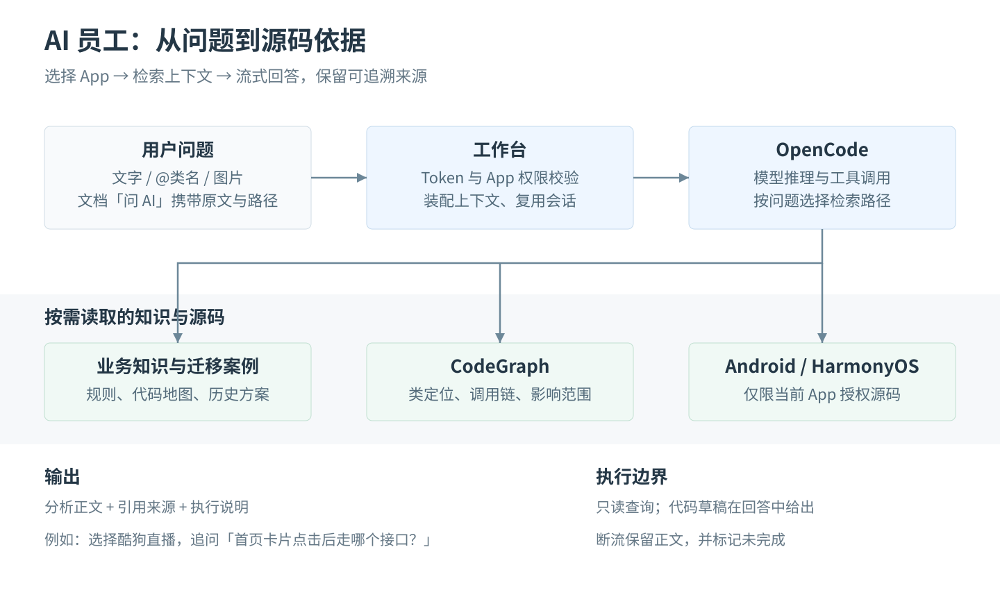

# AI 员工

选择已授权 App，围绕业务问题、类名、接口或图片提问。平台结合知识与双端源码，返回可追溯的分析。

## 一、工作原理

工作台负责权限、上下文和会话；OpenCode 负责模型与工具执行；知识库和源码提供回答依据。
例如：选择示例 App，询问「首页卡片点击后调用哪个接口？」；继续追问可沿用已查到的链路。

## 二、使用

- 输入业务问题或 `@类名`，按需上传附件；连续追问复用会话。
- 从知识文档或正文选区“问 AI”，携带来源、路径、选中文字及映射的 App。
- 页面实时展示正文和执行说明；历史消息不单独展示 reasoning，服务端保留相应元数据。
- 超时或断流保留已生成内容并标记未完成，不把部分回答显示为成功完成。

## 三、检索与权限

知识查询先定位业务文档与代码地图，必要时查迁移案例、CodeGraph 和 App 范围内源码。
已有精确文档上下文时优先复用，不重复扫描整库。当前接口、配置和实现以源码核验为准。

Token 与 App scope 限定源码范围；文档问 AI 不额外授予权限。
AI 员工工作区只读，禁业务代码修改和任意 Shell；代码草稿作为回答返回。
模型由 OpenCode 配置和环境参数共同确定，不能只改一处。

[OpenCode 安装](../../README.md#安装-opencode) · [模型配置](../../runtime/opencode/README.md) · [设计约束](../specs/ai-employee.md)
