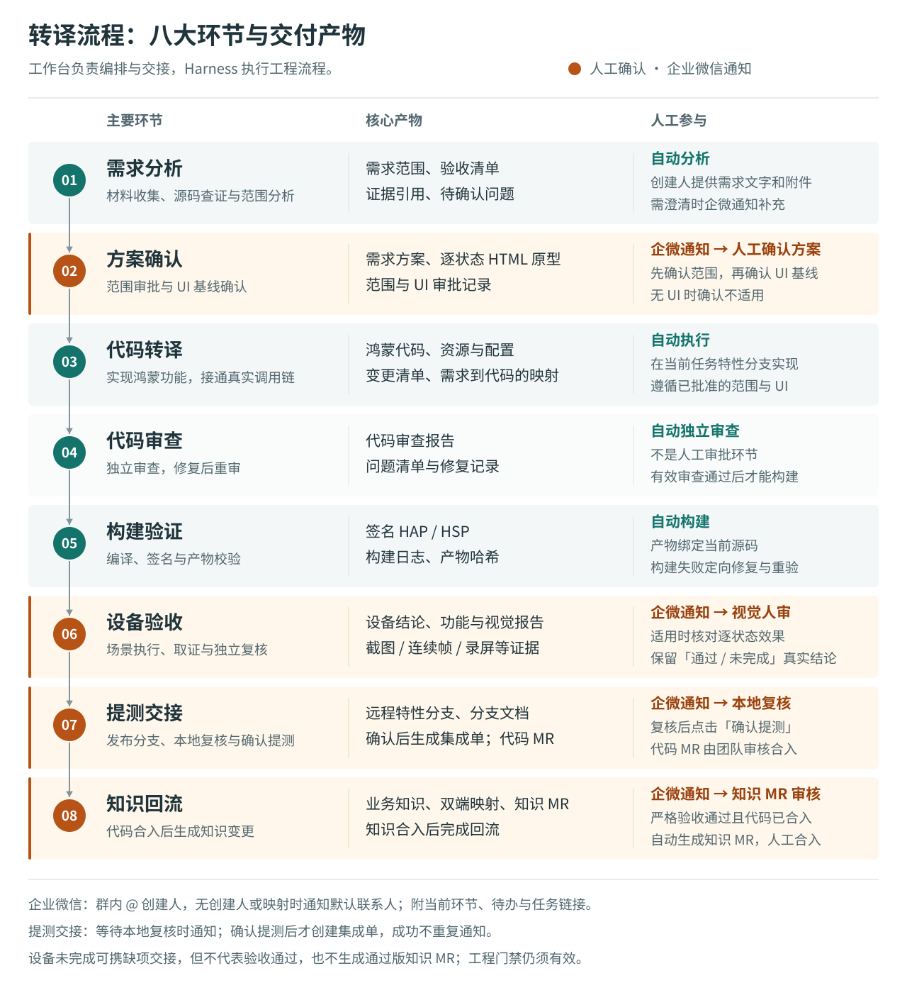
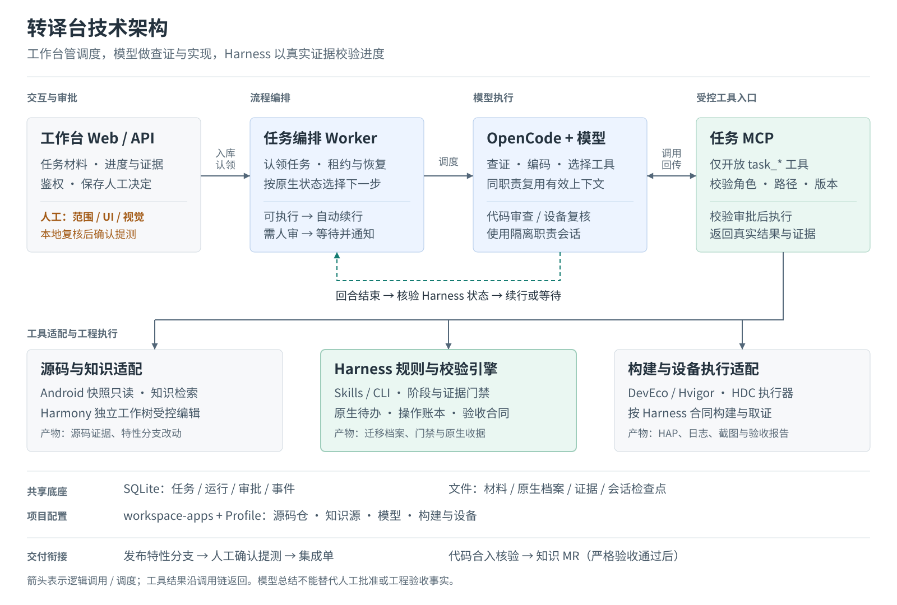

# 转译台

将 Android 需求转为鸿蒙实现，输出代码、构建、设备结论与提测交接。配置键为 `cloud_agent`。

## 一、转译全流程

图中仅保留八个大环节，按纵向箭头阅读：左列是环节，中列是核心产物，右列是人工参与说明；橙色行表示包含人工确认。
需要人工确认或补充材料时，通过企业微信群通知并 @ 创建人；无创建人或接收人映射时通知配置的默认联系人。
通知包含当前环节、待办和任务链接；等待本地复核时发送，确认提测成功后不重复通知。
材料准备并入需求分析，范围与 UI 审批归入方案确认，发布分支和代码 MR 归入提测交接，不另拆节点。[打开原尺寸流程图](../assets/features/cloud-agent.svg)。

工作台管理材料、阶段、审批和交接；OpenCode 调用受控工具完成转译，Harness 校验工程规则并约束构建与设备取证。
范围、UI 与适用的视觉基线由人确认；开发本地复核后确认提测，代码 MR 和知识 MR 分别由团队审核合入。

## 二、技术架构

主调用链是 **Web / API → Worker → OpenCode → 任务 MCP → 工程能力**。箭头表示逻辑调度，
不是 API 同步等待完整任务：Web 先保存任务，独立 Worker 通过数据库认领，页面读取事件与证据展示进度。

| 技术边界 | 职责 |
| --- | --- |
| 工作台编排 | 任务租约、实例启停、故障恢复与人工交接；不是用模型回复直接切换阶段 |
| OpenCode 执行 | 模型查证、编码并选择工具；同任务、同原生运行、同职责且检查点有效时复用会话，审查与设备复核独立隔离 |
| 任务 MCP | 唯一受控工具入口，检查角色、路径、版本及审批；Android 只读，鸿蒙编辑限任务工作树 |
| Harness 校验 | 提供规则、原生待办、证据合同与操作账本；构建和设备结果来自执行器，不接受模型自报通过 |

**自动续行是校验闭环，不是无限重试。** 工具结果返回模型继续推理；回合结束后 Worker 等待工具结算，
核验 Harness 当前状态与剩余待办，有可执行工作才继续。需要审批时通知并释放模型实例；
预算耗尽、持续无进展或副作用未知时保留原因与恢复依据，不靠新会话或新操作 ID 重放。

**交付由平台处理。** 分支发布后等待开发本地复核，人工确认才创建集成单；代码合入经 Webhook 与 Git 核验，
严格验收通过的任务才创建知识 MR。人工确认提测不把未完成设备结论改成通过。

当前 Web 与 Worker 共用 SQLite 和文件目录；转译动态实例不复用 AI 员工或集成台的固定 OpenCode 实例。
任务专用 MCP 不等同于通用知识 MCP。更多进程和存储说明见[工程架构](../engineering/architecture.md)。

## 三、使用流程

1. 选择已授权 App 和允许的鸿蒙分支，提交需求文字或附件；也可由已配置的 Android merged MR 建单。
2. 平台固定源码版本，创建独立工作树与 Harness 档案，查证需求范围和验收项。
3. 人工审核 Scope 与 UI 基线；没有 UI 时确认不适用。批准绑定当前材料与审核包。
4. 自动编码、独立代码审查和构建。P0/P1/P2、缺失或过期审查报告不能进入构建。
5. 本轮设备执行结束后形成“通过”或“未完成”结论，展示场景、视觉状态、缺项及证据。
6. 发布附结论的特性分支，开发本地复核、修复和验收，再点击「已完成本地复核，确认提测」创建集成单。
7. 按团队流程创建与合入代码 MR。严格验收通过的任务核实代码合入后生成知识 MR，知识合入后完成回流。

未完成的设备结论不阻止提测交接，但不改变 Harness 门禁，不生成宣称通过的四文档或知识 MR。
代码审查、构建、源码或材料绑定失效仍须修复；未知设备副作用仍需恢复核验。

## 四、人工节点

| 节点 | 决定范围 |
| --- | --- |
| 方案确认（图 02） | 先确认范围与验收标准，再确认逐状态 UI 基线；无 UI 时确认不适用 |
| 设备验收（图 06） | 适用的视觉状态仍须人审；接受视觉差异不代表功能通过 |
| 提测交接（图 07） | 开发本地复核后确认提测，才创建集成单；代码 MR 由团队创建、审核与合入 |
| 知识回流（图 08） | 知识维护人审核并合入知识 MR；平台核验后完成回流 |

只有有效审核包才显示审批入口；“执行待继续”不是待人工审批。安装授权不替代业务批准。

## 五、任务与材料

- App 范围与 AI 员工一致；显式授权存在时按授权与已启用 App 的交集执行。
- 文字、PDF/DOCX/TXT/MD、PNG/JPEG/WebP、MP4/MOV/WebM；最多 10 个附件、合计 200 MiB。
- 文档和图片单件 10 MiB；视频单件 100 MiB、10 分钟、4K。按需抽帧，无音频转写。
- 运行期间可暂存补料；正式提交重新校验材料与审批。提测后新需求另建任务。
- 页面按任务显示阶段、执行记录和报告；点击节点只查看，不跳过校验。
- 继续操作复用有效档案与证据；源码、包或材料变化后不能沿用旧通过结论。
- 鸿蒙模拟器不支持 HDC 调用系统录屏服务，使用截图、真实连续帧与日志取证；单张静态图不能证明连续播放。

[交付配置](../operations/cloud-agent-delivery.md) · [运行与恢复](../operations/cloud-agent.md) · [设计约束](../specs/cloud-agent.md)
