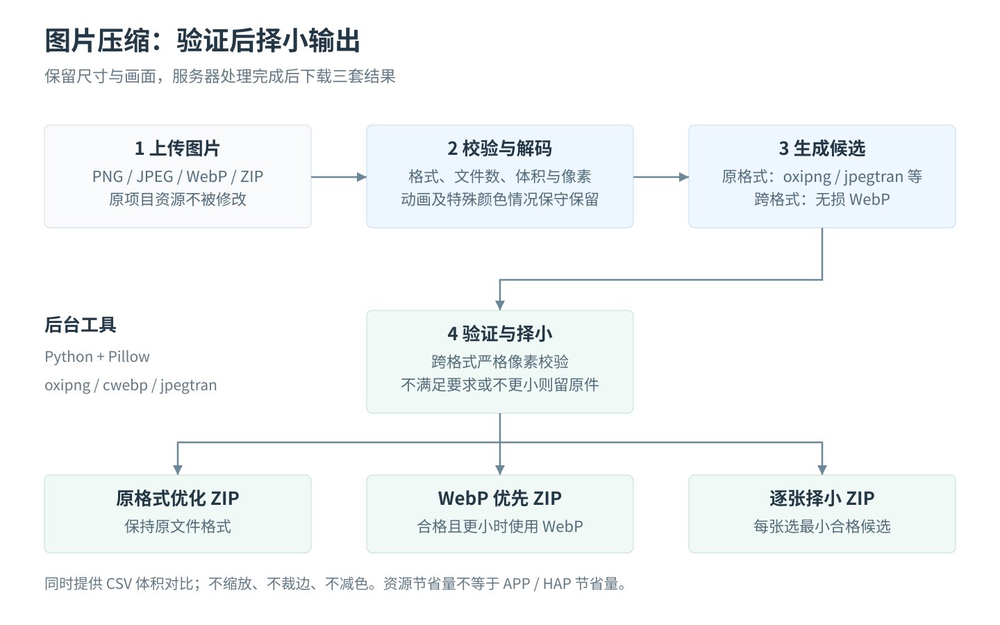

# 图片压缩

入口：`/dashboard?tab=image-compression`。在工作台服务器无损优化图片，不修改项目原资源。

## 一、处理架构

例如：上传一组页面 PNG 资源，下载原格式优化结果或逐张择小结果，再自行替换到项目中。
平台只生成下载产物，不直接修改源码仓。

## 二、使用

上传 PNG、JPEG、WebP 或包含这些格式的 ZIP，完成后下载结果 ZIP 和 CSV：

| 方案 | 处理方式 |
| --- | --- |
| 保留原格式 | PNG 使用 oxipng，JPEG 使用 jpegtran，WebP 无损重编码；与原件择小 |
| WebP 优先 | 严格像素校验通过且更小时转换，否则保留原件 |
| 逐张择小 | 从原件、原格式优化、无损 WebP 中选最小候选 |

不缩放、裁边或减色；动画 PNG/WebP 保留原件。跨格式转换遇到颜色配置、高位深或 CMYK 时保守保留。
RGBA 校验包含透明像素的 RGB；路径冲突自动避让。压缩资源节省量不等于最终 APP/HAP 节省量。

## 三、限制

- 上传 50 MiB、最多 500 张、解压后合计 200 MiB；单图 1600 万像素、整批 1.5 亿像素。
- 每进程最多 2 个处理任务，每 Token 最多 1 个；单任务 10 分钟，单次编码 90 秒。
- 任务状态在内存中；切换页面保留进度，刷新或服务重启后需重新上传。
- 产物下载校验用户身份；处理后删除原件，失败清理工作目录，新上传时回收超过 24 小时的产物。

## 四、部署

依赖 Python 3.9+、Pillow、oxipng、cwebp、jpegtran。标准部署会准备和自检依赖，失败时保留运行服务。

| 变量 | 默认值 |
| --- | --- |
| `IMAGE_COMPRESSION_PYTHON` | `python3` |
| `IMAGE_OXIPNG` / `IMAGE_CWEBP` / `IMAGE_JPEGTRAN` | 对应命令名 |
| `IMAGE_COMPRESSION_DIR` | `.runtime/image-compression` |

用配置的 Python 执行 `server/image-compression/worker.py --check`，确认 `ready: true`。
验证命令：`npm run test:image-compression`、`npm run test:image-compression-api`。
