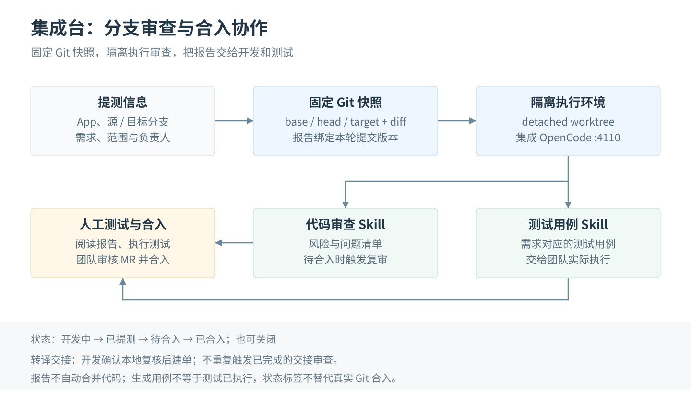

# 集成台

围绕提测分支管理审查、测试和合入状态。自动化生成报告，状态推进与代码合入由人负责。

## 一、执行架构

输入是需求与分支，输出是绑定提交版本的代码审查报告和测试用例。
例如：功能分支提测后，开发处理审查问题，测试按用例验证；进入待合入时再复审最新差异。

## 二、使用流程

| 状态 | 动作 |
| --- | --- |
| 开发中 | 登记 App、源分支、目标分支、需求和范围 |
| 已提测 | 普通任务触发首次代码审查与测试用例生成 |
| 待合入 | 触发合入前复审 |
| 已合入 | 记录团队合入结果 |
| 已关闭 | 停止继续推进 |

转译台交接是独立入口：开发确认本地复核后才创建并标记集成单已提测，不重复触发已完成的交接审查。
转译台仍独立核实 Git 与鉴权 MR 事件，不以人工状态标签代替真实代码合入。

## 三、报告与执行

- 报告绑定 base/head/target 提交和 diff 摘要；变化后重新审查，不沿用旧通过结论。
- 使用独立 detached worktree 和集成 OpenCode，不修改开发者工作区。
- 只运行受控审查与测试用例 Skill，生成 Markdown 报告；生成用例不代表测试已经执行。
- 失败可查看原因并按允许阶段重跑，保留历史报告；报告不会自动合并代码。

OpenCode 默认使用 4110 端口，需安装 `harmony-branch-code-review` 和 `harmony-branch-test-cases`。
配置与隔离说明见 [OpenCode](../../runtime/opencode/README.md)，验证约束见[集成台设计](../specs/integration.md)。
