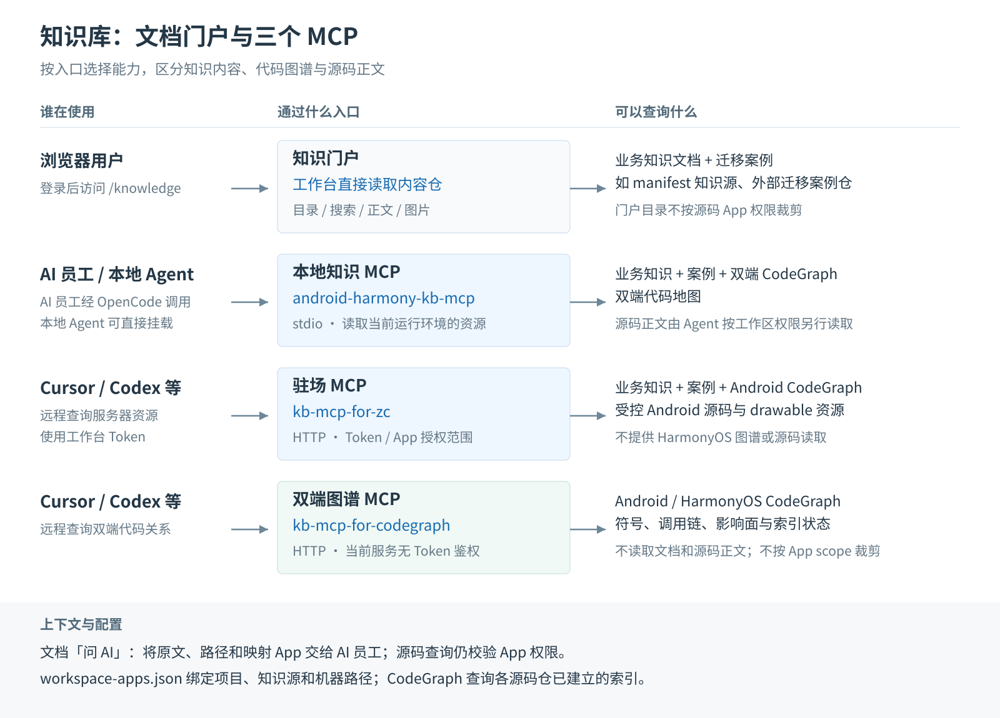

# 知识库

入口：`/knowledge`。统一浏览技术知识和迁移案例，提供目录、全文搜索、资源下载及“问 AI”。

## 一、内容与查询关系



门户直接读取文档内容；AI 员工通过 OpenCode 调用本地知识 MCP，本地 Agent 可按需选择三个 MCP 接入。
图谱查询和源码正文读取是不同能力，各入口的范围与权限见图中对应行及第三节。

## 二、使用与内容来源

1. 打开知识库，选择业务知识或迁移案例，通过目录或搜索找到文档。
2. 阅读正文、查看图片或下载资源；需要解释时，选中文字点击「问 AI」。
3. 核实当前实现时，由 AI 按授权查询源码与 CodeGraph；案例仅作为历史参考。

| 类型 | 用途 | 来源 |
| --- | --- | --- |
| 业务知识 | 当前业务规则、接口路由、双端代码地图 | 项目引用的 manifest 知识库 |
| CodeGraph | 类、调用链、影响范围与双端定位 | 内置 android-harmony-kb 运行包和源码索引 |
| 迁移案例 | 方案、资源、差异与历史验收依据 | 外部迁移案例仓 |
| 项目源码 | 核实当前实现 | 项目配置的 Android / HarmonyOS 范围 |

正文与图片直接读取内容仓，无需独立文档站。案例提供经验，不替代当前业务规则或源码。

## 三、三个 MCP 怎么选

MCP 让 Cursor、Codex、OpenCode 等 Agent 调用知识和代码查询工具。项目提供三个接入，按使用场景选择，无需全部启用。

| MCP | 适用场景 | 能力 | 接入方式 |
| --- | --- | --- | --- |
| `android-harmony-kb-mcp` | 本地已准备源码、知识仓和索引；工作台 AI 员工也使用此入口 | 业务知识、迁移案例、双端 CodeGraph、双端代码地图 | 本地 stdio，由 Agent 启动 Node 进程 |
| `kb-mcp-for-zc` | 本地 Agent 需要查询服务器上的知识与 Android 源码 | 业务知识、迁移案例、Android CodeGraph、受控 Android 源码及 drawable 资源 | HTTP + 工作台 Token，按授权范围查询 |
| `kb-mcp-for-codegraph` | 只需双端符号、调用链和影响面 | Android / HarmonyOS CodeGraph，不提供文档和源码正文 | HTTP；生产部署必须置于回环地址或带鉴权的反向代理后 |

以下 JSON 使用 Cursor 的 `mcpServers` 格式；Codex 等客户端按自身格式配置相同的命令、URL 和鉴权信息。
`127.0.0.1` 只适用于服务就在本机的情况，远程使用实际部署地址。

### 1. 本地知识 MCP：android-harmony-kb-mcp

**准备与接入：** 在工作台根目录安装依赖，按 [项目接入配置](../engineering/integrations/android-external-app-repos.md) 设置源码、知识库路径及 `WORKSPACE_PROFILE`，准备对应 CodeGraph 索引。
在 Cursor 项目的 `.cursor/mcp.json` 中添加以下配置，将脚本路径换成实际绝对路径：

```json
{
  "mcpServers": {
    "android-harmony-kb-mcp": {
      "command": "node",
      "args": ["/path/to/workbench/packages/android-harmony-kb/scripts/mcp/harmony-kb-mcp.mjs"],
      "env": { "WORKSPACE_PROFILE": "local-windows" }
    }
  }
}
```

**怎么用：** 先查业务知识或案例，再查对应平台的图谱；需要源码正文时，由 Agent 读取本地授权工作区。此 MCP 本身不提供 `kb_source_read`，也不使用驻场网关的 Token 鉴权。

> 示例提问：用 android-harmony-kb-mcp 查示例项目首页卡片的业务规则，分别定位 Android 和 HarmonyOS 实现，列出来源与差异。

调用时显式指定配置中的 `project_id`（示例为 `demo-project`）；图谱分别使用 `platform: "android"` 和 `platform: "harmonyos"`。已知 `feature_id` 时可直接调用 `get_feature_context`；已取得 `doc_ref` 时直接读取对应章节。

工作台 AI 员工的 OpenCode 已通过 [实例配置](../../runtime/agents/harmony/instance.json) 挂载此 MCP；普通 Web 用户无需配置本地 MCP。

### 2. 驻场 MCP：kb-mcp-for-zc

**接入：** 登录工作台，打开 `/dashboard?tab=mcp`，复制「驻场 MCP 接入」配置。页面提供当前网关地址和自己的 Token；配置结构如下：

```json
{
  "mcpServers": {
    "kb-mcp-for-zc": {
      "url": "http://127.0.0.1:8420/mcp",
      "headers": { "Authorization": "Bearer hm_YOUR_TOKEN" }
    }
  }
}
```

**怎么用：** Agent 先查知识，再用 Android 图谱定位类和方法，最后按需读取服务器端源码，无需在本地准备 Android 源码仓。

> 示例提问：用 kb-mcp-for-zc 查示例项目首页卡片点击链路，先定位调用关系，再读取相关 Android 方法并标注文件位置。

典型顺序：`kb_knowledge_search/read` → `kb_codegraph_explore` → `kb_codegraph_callers/callees` → `kb_source_read` 或 `kb_source_grep`。查询使用已授权的 `project_id`；该网关的图谱和源码读取仅支持 Android，查询 HarmonyOS 图谱使用另外两个 MCP。

### 3. 双端图谱 MCP：kb-mcp-for-codegraph

**接入：** 配置已部署图谱服务的 `/mcp` 地址；以下为本机默认地址：

```json
{
  "mcpServers": {
    "kb-mcp-for-codegraph": { "url": "http://127.0.0.1:8421/mcp" }
  }
}
```

**怎么用：** 适合查类、方法、调用关系和改动影响。项目标识和平台来自当前 workspace 配置，平台为 `android` 或 `harmonyos`。先定位符号，再用返回的符号标识继续查询，不猜测符号或路径。

> 示例提问：用 kb-mcp-for-codegraph 定位示例项目 HarmonyOS 首页相关符号，查调用方和修改影响；需要源码正文时再读取本地文件。

例如先调用 `kb_codegraph_explore`，参数为 `{"project_id":"demo-project","platform":"harmonyos","query":"首页"}`；再按返回结果调用 `kb_codegraph_callers`、`kb_codegraph_callees` 或 `kb_codegraph_impact`。未命中时用 `kb_codegraph_status` 检查索引覆盖与状态。

### 常用工具速查

| 目标 | 工具 | 哪些 MCP 提供 |
| --- | --- | --- |
| 查知识源、搜业务规则、读精确章节 | `kb_knowledge_sources/search/read`、`get_feature_context` | 本地、驻场 |
| 搜迁移案例、分段阅读 | `kb_wiki_search/read` | 本地、驻场 |
| 查双端代码地图 | `kb_resolve_counterpart` | 本地、驻场；驻场从 Android 侧查映射，不读取鸿蒙源码 |
| 查符号、调用链、影响面、索引状态 | `kb_codegraph_*` | 三者均有；驻场仅 Android |
| 读取、搜索远程源码及查 drawable | `kb_source_read/grep/fetch_drawable` | 驻场，仅授权 Android 范围 |

接入后在客户端刷新 MCP 工具列表，并用目标项目做一次查询。知识无命中时检查项目绑定与内容；图谱无命中时检查索引；驻场权限报错时核对 Token 的 App 授权。
三个入口的完整配置模板见 [MCP 配置目录](../../packages/android-harmony-kb/config/mcp/)，索引准备命令见 [知识运行包](../../packages/android-harmony-kb/README.md#常用命令)。

## 四、访问与更新

- 技术知识与迁移案例门户登录可见；源码 App 授权不裁剪门户目录。
- `content_root` 是读取根，`tree_root` 是展示起点；相对文档和资源链接经鉴权读取。
- `path_targets` 仅推导“问 AI”的源码 App，查询仍检查源码权限。
- AI/MCP 检索使用项目 knowledge 引用、adapter、targets 和能力声明。
- Webhook 拉取最新知识内容；生产 manifest 的任务由知识仓负责。
- 平台管理查看文档阅读、搜索、知识命中与 CodeGraph 调用统计。

[接入配置](../engineering/integrations/android-external-app-repos.md) · [案例编写](migration-case-authoring.md) · [设计约束](../specs/knowledge.md)
