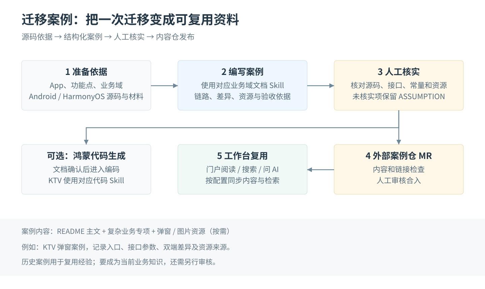

# 迁移案例编写

案例记录一次迁移的业务链路、资源、差异和验收依据，属于历史证据。内容维护在外部案例仓；
当前业务规则应另经审核进入业务知识库。

## 一、编写与发布流程



例如：为一个 KTV 弹窗编写案例，记录入口、接口参数、双端差异和资源来源，审核后发布到案例仓。
工作台读取已配置的内容仓；新增案例不需要另建文档服务。

## 二、输入与工具

- 明确 App、Android 源文件或功能点、业务域、输出目录；按需提供鸿蒙目录和设计材料。
- KTV 文档使用 `android-to-harmony-doc-ktv`，人工确认后再用 `ohos-harmony-code-gen-ktv` 生成代码。
- 其他业务域补充相应规则，不套用 KTV 专属接口和页面约定。
- 输出到 `docs/migration/<项目栏目>/<业务域>/<案例目录>/`；指定已有栏目时直接写入该目录。

## 三、目录与内容

```text
<案例目录>/
├── README.md       业务链路、源码依据、差异、验收结论与索引
├── delegates/      复杂业务专项
├── dialogs/        弹窗专项（可选）
└── drawable/       资源及来源说明（可选）
```

追踪入口、父类、布局、Delegate、接口、事件、常量、资源及鸿蒙对应实现。
未核实项标记 `ASSUMPTION`；图片与文档使用相对链接，资源按实际密度保存。
门户由 `shared_knowledge_bases[].portal` 发布，`path_targets` 只选择“问 AI”的源码 App，不限制案例阅读。

## 四、验证与发布

```bash
npm run test:migration-case-links
npm run test:knowledge-portal
npm run kb:test:migration-wiki
```

最后一项适用于进入 KB 迁移索引的案例。在 `/knowledge` 检查目录、正文、图片、搜索和“问 AI”。
人工核对业务完整性、源码引用、参数常量、资源与推断标记后，向案例仓提交 MR；工作台配置单独提交。

详细成文规则见 [KTV 文档 Skill](../../.agents/skills/android-to-harmony-doc-ktv/SKILL.md)。
