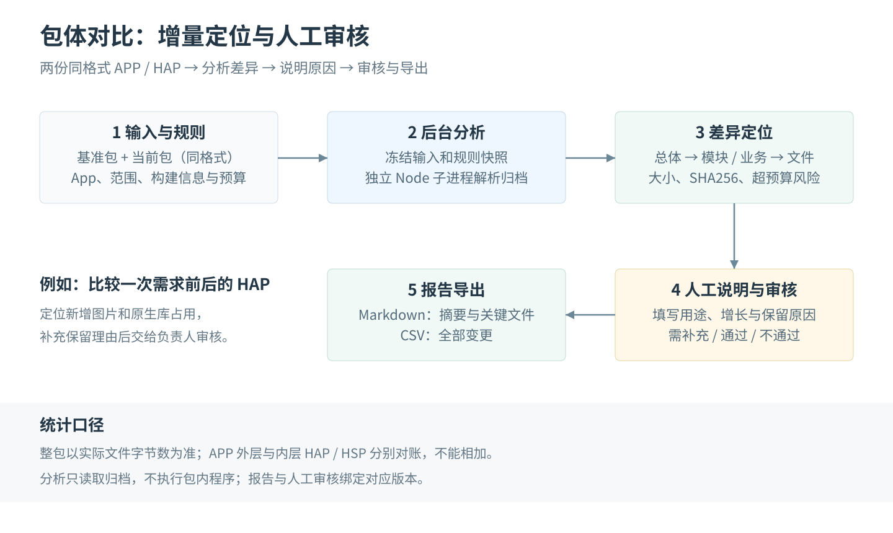

# 包体对比

入口：`/dashboard?tab=package-comparison`。比较两份同格式 HarmonyOS APP 或 HAP，分析增量并人工审核。

## 一、分析架构

例如：上传需求前后的两份 HAP，查看增长来自哪些图片或原生库，填写原因后交给负责人审核。
最终得到差异报告和人工决定，预算提醒本身不代表审核通过。

## 二、使用

1. 选择 App、场景和负责人，上传或选择基准包与当前包，填写需求范围和构建信息。
2. 按需调整预算、阈值和项目规则，创建后台分析任务。
3. 查看总体、模块、分类、业务、文件和原生库差异，补充用途与保留原因。
4. 提交审核，人工决定“需补充 / 通过 / 不通过”。
5. 导出 Markdown 或完整变化清单 CSV；有未保存说明时先保存。

所有有效登录用户均可访问全部启用项目，不受 Token 的 App 范围限制；服务端仍校验登录状态与项目是否启用。分析可关闭页面后继续，历史任务可查进度与失败原因。

## 三、统计口径

| 项目 | 规则 |
| --- | --- |
| 总体 | 上传文件的实际字节数；APP 与 HAP 不混比 |
| 文件匹配 | 模块标识 + 完整路径；SHA256 识别同大小修改，移动视为删除与新增 |
| 占用 | ZIP 条目压缩长度；解压长度单列，结构开销参与字节对账 |
| APP 内部 | 展开一层 HAP/HSP；内部统计与外层独立对账，不能相加 |
| 展示 | KB = 1024 B；聚合基于完整清单，明细与导出显示新增、删除和修改 |
| 导出 | Markdown 外层、内层关键文件各最多 200 条；CSV 包含全部变更 |
| 不支持 | 独立 HSP/APK/AAB/IPA、ZIP64、多卷、加密、深层展开和安装后体积 |

更深嵌套归档标记“部分完成”。重复占用不直接等于可节省体积；预算仅作用于上传整包。
release/debug 从清单读取，缺失显示未知；不根据文件名推断。

## 四、规则与审核

默认规则见 [配置示例](../../config/package-comparison.example.json)，由 `PACKAGE_COMPARISON_CONFIG` 指向按 App ID 配置的 JSON。

- `budgetBytes`、`largeFileBytes`、`fileGrowthBytes`、`growthPercent`：预算与提醒阈值，可为空。
- `imageFileBytes`：默认 15360 字节；超过才提醒，空值关闭，0 提醒所有非空新增/增大图片。
- `modules`、`groups`、`categories`：按路径、扩展名配置模块、业务与分类，数组优先匹配。
- 规则和输入在建单时冻结；重新分析沿用原快照并增加分析版本，换输入或规则需新建任务。
- 评估列出超预算、图片/文件增长、架构与范围风险，不自动给出人工通过。
- 审核绑定产物、分析和说明版本；修改说明恢复草稿，旧决定保留，过期页面不能覆盖新版本。

## 五、运行配置

| 变量 | 默认值 |
| --- | --- |
| `PACKAGE_STORAGE_DIR` | `.runtime/package-comparison`，私有产物目录 |
| `PACKAGE_UPLOAD_BYTES` | 512 MiB |
| `PACKAGE_FILE_BYTES` | 256 MiB；内部 HAP/HSP 容器按上传限额 |
| `PACKAGE_EXPANDED_BYTES` / `PACKAGE_FILE_COUNT` | 2 GiB / 30000，内外层累计 |
| `PACKAGE_ANALYSIS_TIMEOUT_MS` | 180000 |
| `PACKAGE_ANALYSIS_CONCURRENCY` | 1，可配置 1–4 |
| `PACKAGE_RETENTION_DAYS` | 30；保留报告和审核记录 |

独立 Node 子进程分析，SQLite 认领与租约限制并发；输入摘要变化拒绝复算。
不执行包内程序，拒绝路径穿越、链接、重复/重叠条目、损坏或超限包。
过期包与临时目录可清理，运行中产物受保护；原包删除后报告标记复算受限。

验证命令：`npm run test:package-comparison`、`npm run test:package-comparison-api`。
