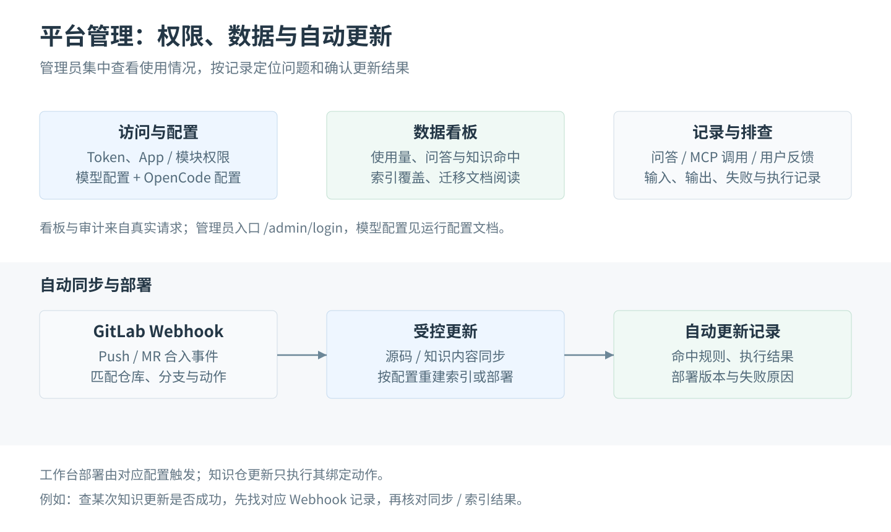

# 平台管理

入口：`/admin/login`，使用管理员身份。负责权限、使用数据、请求审计和仓库更新。

## 一、管理范围

权限配置决定谁能使用哪些能力；看板汇总实际使用数据；执行记录用于追查每次请求和更新结果。

## 二、功能入口

| 模块 | 用途 |
| --- | --- |
| Token 与权限 | 创建、轮换、撤销 Token，分配 App 与模块访问范围 |
| 模型配置 | 通过运行配置管理模型与凭据，配合对应 OpenCode 配置 |
| 仪表盘 / 问答统计 | 查看使用量、趋势、人员与请求状态 |
| 知识库看板 | 查看索引覆盖、知识命中、CodeGraph 调用与检索效果 |
| 迁移文档看板 | 查看热门文档、阅读与搜索数据 |
| 问答 / MCP 记录 | 排查输入、输出、工具调用和失败 |
| 自动更新记录 | 查看 Webhook 匹配、源码/知识更新、索引重建与部署结果 |
| 用户反馈 | 查看和处理使用问题 |

## 三、常见操作

- 新成员接入：创建 Token，配置 App 与模块权限，核对其可见入口。
- 问答失败：在问答 / MCP 记录找到对应请求，查看失败信息和工具执行结果。
- 知识更新：检查自动更新记录中的仓库、分支和动作，再核对同步与索引结果。
- 工作台部署：检查对应部署动作与运行版本；其他知识仓不会因此自动部署工作台。

看板数据来自实际请求与遥测；知识命中不等于业务结论正确，生成报告不等于设备验收通过。
仓库更新按已配置的 remote、分支与动作执行，失败查原记录，不凭页面刷新推断成功。

[模型运行配置](../../runtime/opencode/README.md) · [Webhook 配置与排查](../operations/repo-sync-webhook.md) · [转译任务恢复](../operations/cloud-agent.md)
